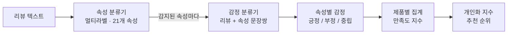

# 한국어 화장품 리뷰 ABSA (속성 기반 감정 분석)

> 리뷰 텍스트 한 줄에서 **어떤 속성**(보습력, 가격, 향 …)을 말하는지 찾고, **속성별로 긍정·부정·중립**을 판별하는 KLUE-RoBERTa 기반 2단계 파이프라인.
> 그 결과로 제품별 **만족도 지수**와 내가 중시하는 속성을 반영한 **개인화 추천 순위**까지 만듭니다.

**▶ 웹 데모: [seoyunkim129.github.io/korean-cosmetic-absa/demo/](https://seoyunkim129.github.io/korean-cosmetic-absa/demo/)** — 올리브영 기초케어 34개 제품 · 리뷰 1,655건

`Python` `PyTorch` `HuggingFace Transformers` `KLUE-RoBERTa` `KLUE-BERT` `Google Colab`

동덕여자대학교 데이터사이언스전공 캡스톤 · 2인 팀 (김서윤, 장지안)

---

## 1. 문제 정의

올리브영 같은 화장품 플랫폼의 리뷰는 별점과 몇 가지 선택지(피부타입, 자극도 등)만 구조화되어 있습니다.
"가격은 비싸지만 효과는 좋다"처럼 **한 리뷰 안에서도 속성마다 평가가 다른** 정보는 긴 텍스트를 직접 읽어야만 알 수 있습니다.

이 프로젝트는 리뷰 텍스트만 입력하면 속성과 속성별 감정을 자동으로 뽑아, 제품을 속성 단위로 비교할 수 있게 하는 것을 목표로 합니다.

## 2. 데이터

| 항목 | 내용 |
|---|---|
| 출처 | AI Hub 한국어 속성기반 감성분석 데이터 – 기초케어 쇼핑몰 리뷰 |
| 규모 | 38,603행 (리뷰 12,000개, 리뷰당 평균 3.22개 속성) |
| 레이블 | 속성 24종 → 21종 사용, 감정 3종 (긍정·부정·중립) |
| 분할 | 리뷰 Index 기준 train 70% / valid 15% / test 15% |

- **데이터 누수 방지**: 한 리뷰가 여러 행(속성)으로 나뉘어 있어, 행 단위로 나누면 같은 리뷰가 train과 test에 동시에 들어갑니다. 리뷰 Index 기준으로 분할했습니다.
- **극소 속성 제외**: 밀착력/접착력(6건), 커버력(5건), 색상(27건)은 학습이 불가능한 수준이라 제외하고 21개 속성으로 운영했습니다.
- 원본 데이터는 AI Hub 이용 약관상 저장소에 포함하지 않습니다.

## 3. 접근 방법



### 속성 분류기 (Aspect Classifier)
- 리뷰 하나에 속성이 여러 개 있으므로 **멀티라벨 분류** + `BCEWithLogitsLoss`
- 속성별 데이터 불균형을 `pos_weight`로 보정
- Threshold를 0.3~0.7로 바꿔가며 Precision·Recall 균형을 비교해 **0.6** 선택

### 감정 분류기 (Aspect Sentiment Classifier)
- `[CLS] 리뷰 [SEP] 속성 [SEP]` 문장쌍 입력 → 같은 리뷰라도 속성에 따라 다른 감정을 예측
- 긍정 70% / 중립 8%의 불균형을 `CrossEntropyLoss`의 `class_weight`로 보정
- 소수 클래스(부정·중립)를 공평하게 평가하기 위해 Accuracy 대신 **Macro F1**을 주요 지표로 사용
- KLUE-BERT vs KLUE-RoBERTa를 같은 조건으로 비교

공통 하이퍼파라미터: Epoch 5 · LR 2e-5 · MAX_LEN 192 · Batch 16

### 만족도 지수와 추천 (올리브영 적용)
- **기본 만족도 지수**: 속성별 긍정 비율을, 그 제품 리뷰에서 그 속성이 언급된 비율로 가중 평균합니다. 고정 가중치를 쓰지 않은 이유는 제품마다 관심사가 달랐기 때문입니다 — 가성비 토너는 자극성·용량, 진정 크림은 보습력·흡수력, 고가 세럼은 가격이 가장 많이 언급됐습니다.
- **개인화 지수**: 사용자가 고른 속성의 긍정 비율 × 0.5 + 나머지 속성의 동적 가중 평균 × 0.5. 고른 속성 하나만 보면 그 속성은 좋지만 다른 속성이 나쁜 제품이 1위가 될 수 있어서 반반으로 섞었습니다.
- **표본 기준**: 속성 결과는 언급 5건 이상만 표시, 추천 순위는 고른 속성이 10건 이상 언급된 제품만 넣습니다 (언급 2건에 긍정 100%인 제품이 1위가 되는 것을 막기 위해). 참고용 표시와 순위 매기기에 요구하는 신뢰 수준을 다르게 뒀습니다.

## 4. 결과 (Test set)

### 속성 분류기 – Threshold 비교

| Threshold | Macro F1 | Precision | Recall |
|---|---|---|---|
| 0.5 | 0.918 | 0.884 | 0.958 |
| **0.6 (채택)** | **0.932** | **0.918** | **0.949** |
| 0.7 | 0.933 | 0.935 | 0.936 |

0.7이 F1은 근소하게 높지만 Recall이 떨어져, 속성을 놓치지 않는 쪽을 택해 0.6으로 정했습니다.

### 감정 분류기 – 모델 비교

| 모델 | Accuracy | Macro F1 | 부정 F1 | 중립 F1 | 긍정 F1 |
|---|---|---|---|---|---|
| KLUE-BERT | 0.941 | 0.889 | 0.928 | 0.772 | 0.968 |
| **KLUE-RoBERTa (채택)** | **0.944** | **0.892** | **0.928** | **0.778** | **0.970** |

두 모델 모두 Val Loss는 1~2에폭 이후 올랐지만 Val Macro F1은 계속 올라서, Loss 대신 **Val Macro F1이 가장 높은 에폭을 저장**했습니다. RoBERTa는 세 클래스 모두 같거나 근소하게 높아 채택했습니다.

### 예측 예시

| 리뷰 | 속성 | 예측 |
|---|---|---|
| 가격은 좀 비싸지만 효과는 확실히 좋네요. | 가격 | 부정 |
| 가격은 좀 비싸지만 효과는 확실히 좋네요. | 기능/효과 | 긍정 |

같은 문장이라도 속성에 따라 감정이 다르게 분류되는 것이 ABSA의 핵심입니다.

### 올리브영 리뷰에 적용한 결과
- **평균이 가린 불만**: VT 리들샷 에센스는 자극성 언급 37건 중 23건(62.2%)이 부정이었지만, 같은 제품의 윤기/피부(톤) 29건은 모두 긍정이었습니다. "결은 좋아졌는데 따끔하다"는 리뷰가 한 점수로 평균되면 보이지 않는 정보입니다.
- 제품별 결과와 추천 순위는 [웹 데모](https://seoyunkim129.github.io/korean-cosmetic-absa/demo/)에서 직접 볼 수 있습니다.

### 실제 성능 검증 (진행 중)
위 점수는 AI Hub 테스트셋 기준입니다. 학습에 쓰지 않은 **올리브영 리뷰**에서도 그만큼 맞히는지 보려고, 제품당 5건씩 170건을 뽑아 정답을 만들고 있습니다.
- LLM이 모델 예측을 보지 않고 1차 라벨 → 모델과 갈린 항목(351개)과 합의 항목 일부(20개, 둘이 같이 틀리는 비율 측정용)만 사람이 **누가 낸 답인지 모르는 상태로** 판정
- 결과는 속성 감지 · 감정 분류 · end-to-end로 나눠 이 README에 추가할 예정입니다

### 다음 계획 — 데이터 확대
크롤링 범위를 넓히는 대신, 정답 라벨이 있는 AI Hub 화장품 4개 카테고리(약 5만 건)로 학습·평가를 넓히고 적재·검증·배포를 자동화합니다. 올리브영은 봇 접근을 막고 있고 약관상 정보의 무단 복제를 금지해, 정기 자동 크롤링은 하지 않기로 했습니다. 조사 내용과 설계는 [docs/data-expansion-plan.md](docs/data-expansion-plan.md)에 있습니다.

## 5. 저장소 구조

```
korean-cosmetic-absa/
├── notebooks/                          # 학습 (Google Colab)
│   ├── 01_aspect_classifier.ipynb      # 속성 분류기 (멀티라벨, 21개 속성)
│   ├── 02_sentiment_klue_bert.ipynb    # 감정 분류기 – KLUE-BERT (비교 실험)
│   └── 03_sentiment_klue_roberta.ipynb # 감정 분류기 – KLUE-RoBERTa (최종)
├── src/                                # 추론·서비스·검증 (로컬, CPU로도 동작)
│   ├── pipeline.py                     # 올리브영 리뷰 전체 → 리뷰×속성 감정 예측
│   ├── check_results.py                # 노트북 결과와 대조, 제품·속성별 분포 확인
│   ├── build_demo_data.py              # 예측 → 제품별 집계·만족도·개인화 지수 (데모 데이터)
│   ├── make_sample.py                  # 검증용 층화 샘플 (제품당 5건)
│   ├── make_review_queue.py            # LLM 라벨과 모델이 갈린 항목 → 판정 큐
│   ├── label_server.py                 # 라벨링·판정 화면 로컬 서버
│   └── evaluate.py                     # 사람이 확정한 정답으로 실제 성능 측정
├── web/                                # 라벨링(labeler.html)·판정(review.html) 화면
├── docs/
│   ├── demo/                           # 웹 데모 (GitHub Pages)
│   ├── data-expansion-plan.md          # 데이터 확대 사전 조사·설계
│   └── poster.pdf                      # 학술 발표 포스터
└── requirements.txt
```

## 6. 실행 방법

**학습** — Google Colab(GPU)에서 AI Hub 데이터 경로를 맞추고 `01` → `03` 순서로 실행합니다. `02`는 모델 비교용입니다.

**추론과 데모** — 학습한 가중치 2개(`aspect_classifier_v2_21cls.pth`, `klueroberta_sentiment_best.pth`)와 데이터를 `data/`에 두고:

```bash
pip install torch --index-url https://download.pytorch.org/whl/cpu
pip install -r requirements.txt
python src/pipeline.py          # outputs/predictions.csv (리뷰 1,655건, CPU에서 수십 분)
python src/check_results.py     # Colab 파이프라인 결과와 대조 → 262행 모두 일치
python src/build_demo_data.py   # docs/demo/data.js
```

가중치·AI Hub 원본·크롤링한 리뷰 원문은 용량과 이용 약관 때문에 저장소에 넣지 않습니다. 데모에도 리뷰 원문 없이 집계 수치만 담았습니다.

## 7. 담당 역할

- 모델링·파이프라인 설계: 속성 분류기와 감정 분류기 학습, 데이터 분할 설계
- 만족도 지수·개인화 추천 설계 및 학술 발표
- 캡스톤 이후: 파이프라인 스크립트화와 재현 확인, 웹 데모, 실제 성능 검증 설계

## 8. 회고 및 한계

- **데이터 누수 발견과 수정**: 초기 행 단위 분할에서 같은 리뷰가 train·test에 함께 들어가는 누수를 발견해, 리뷰 단위 분할로 바로잡았습니다.
- **중립 클래스**: 데이터가 8%뿐이라 F1이 0.78로 가장 낮습니다. 데이터 증강이나 중립 전용 샘플링이 다음 과제입니다.
- **도메인 차이**: 학습은 AI Hub 쇼핑몰 리뷰로, 적용 대상은 올리브영 리뷰라 문체 차이가 있을 수 있습니다. 이 차이를 숫자로 재는 것이 위의 실제 성능 검증입니다.
- **소량 데이터**: 제품당 리뷰 약 50건이라 속성별 언급은 5~30건 수준입니다. 그래서 비율 옆에 언급 수를 함께 표시하고, 순위에는 더 높은 표본 기준을 뒀습니다.
- **긍정 편향**: 만족한 사람이 리뷰를 더 쓰기 때문에 전반적으로 긍정 비율이 높습니다. 모델이 아니라 데이터의 특성입니다.
- **같은 사람의 반복 리뷰**: 문장만 조금 바꿔 여러 번 올린 리뷰가 있어 일부 제품의 속성 비율이 한쪽으로 쏠릴 수 있습니다.
