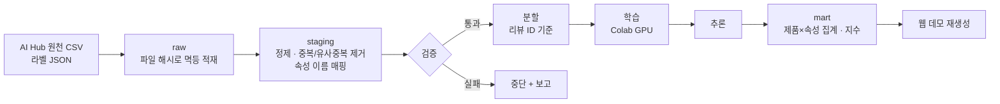

# 데이터 확대 — 사전 조사와 설계안

> 2026-10-18 작성. "크롤링 범위를 넓혀 데이터를 늘리자"는 계획을 실제로 하기 전에, 해도 되는지와 더 나은 방법이 있는지부터 확인했다.

## 결론 먼저

**올리브영 리뷰를 정기적으로 자동 크롤링하는 방식은 하지 않는다.** 대신 데이터 확대를 두 갈래로 나눈다.

| | 무엇을 | 왜 |
|---|---|---|
| **A. 라벨 데이터 확대** | AI Hub '속성 기반 감성분석 데이터' 화장품 도메인 전체(4개 카테고리, 약 5만 건)로 학습·평가 범위를 넓힌다. 지금은 스킨케어 12,000건만 쓴다 | 정답 라벨이 있는 공개 데이터라 성능을 제대로 잴 수 있고, 이용 조건 안에서 쓸 수 있다 |
| **B. 파이프라인 자동화** | 데이터가 들어오면 적재 → 정제·검증 → 추론 → 집계·지수 → 데모 재생성까지 한 번에 돌게 만든다 | "많이 모았다"보다 "새 데이터가 와도 같은 품질로 다시 돌아간다"가 데이터 엔지니어링 역량을 더 잘 보여 준다 |

올리브영 데이터는 이미 모은 1,655건을 **집계 수치로만** 계속 쓴다. 더 필요하면 올리브영 제휴 제안 창구로 연구 목적 제공을 문의하는 것이 정석이다.

## 1. 확인한 것

| 항목 | 확인 내용 | 근거 |
|---|---|---|
| 기술적 접근 제한 | 브라우저가 아닌 요청은 `robots.txt`조차 **HTTP 403 + Cloudflare 확인 페이지**("잠시만 기다려 주세요")로 막힌다 | 2026-10-18 직접 요청 |
| 이용약관 제17조 ① 3호 | 서비스로 얻은 정보를 회사의 사전 승낙 없이 **목적 외로 사용하거나 복제·유통·상업적으로 이용하려는 행위** 금지 | 올리브영 이용약관 v4.1 (2026-08-20 시행) |
| 이용약관 제29조 ② | 서비스로 얻은 정보를 사전 승낙 없이 복제·송신·배포 등으로 **영리 목적 이용** 또는 제3자 이용 금지 | 같음 |
| 이용약관 제29조 ③ | 리뷰 등 게시물의 권리는 **게시한 이용자**에게 있다 → 리뷰 원문을 다시 배포하면 작성자 권리 문제도 생긴다 | 같음 |
| 크롤링 판례 (형사) | 여기어때 사건 — 정보통신망 침입·업무방해·DB권 침해 모두 **무죄 확정**(대법원 2022.5). 근거 중 하나가 "로그인·접근 제한 장치가 없었다"는 점 | 보도·법률 해설 |
| 크롤링 판례 (민사) | 같은 사건 민사에서는 **부정경쟁방지법(타인의 성과 무단 사용)** 으로 10억 원 배상, 항소심 유지 | 보도·법률 해설 |
| 공개 라벨 데이터 | AI Hub '속성 기반 감성분석 데이터' 화장품 도메인 = 스킨케어 16,341 · 헤어/바디케어 15,420 · 메이크업/뷰티소품 13,485 · 남성 화장품 4,750, **총 49,996건**. 카테고리마다 속성 이름·범주가 다르다 | 정희원·정영섭, 한국컴퓨터정보학회 동계학술대회 2024 |

**해석**: 형사 무죄의 핵심 논리였던 "접근 제한이 없었다"가 올리브영에는 해당하지 않는다(봇 확인 장치가 있음). 이를 우회하는 수집은 기술적으로도, 법적으로도, 그리고 "검증을 중시한다"는 이 프로젝트의 메시지와도 맞지 않는다. 비영리 학습 목적이라도 대량·반복 수집은 약관 제17조와 민사 위험을 피하기 어렵다.

## 2. 선택지 비교

| 방법 | 늘어나는 데이터 | 정답 라벨 | 위험 | 포폴에서 보여 주는 것 | 판단 |
|---|---|---|---|---|---|
| 올리브영 정기 자동 크롤링 | 제품·리뷰 수 제한 없음 | 없음 | 높음 (접근 제한 우회, 약관, 민사) | 수집 기술 | ✗ |
| 올리브영 소량 수동 수집 | 수십~수백 건 | 없음 | 중간 (약관 제17조) | 거의 없음 | ✗ |
| 올리브영 제휴 문의 | 협의에 따라 | 없음 | 없음 | 데이터 확보 절차 | △ 시도해 볼 만함 |
| **AI Hub 화장품 4개 카테고리** | **12,000 → 약 50,000건** | **있음** | 없음 (이용 조건 준수) | 카테고리 간 일반화, 속성 체계 통합 | ✓ |
| **파이프라인 자동화** | — | — | 없음 | 적재·검증·재현·배포 자동화 | ✓ |

## 3. 추천안 설계

### 3-1. 데이터 흐름

- **저장소: DuckDB 파일 하나**에 `raw / staging / mart` 계층. 서버 없이 SQL로 다룰 수 있고, 회사에서 Snowflake로 했던 계층 구조(RAW → 가공 → 조회용)를 그대로 옮길 수 있다.
- **멱등 적재**: 파일 해시를 기록해 같은 파일을 두 번 넣어도 결과가 같게.
- **속성 이름 매핑 표**: 카테고리마다 속성 이름이 달라서(예: 메이크업의 커버력·지속력) 공통 속성과 카테고리 전용 속성을 나누는 매핑 표를 둔다.

### 3-2. 자동 검증 (실패하면 다음 단계로 안 넘어감)

| 검증 | 이유 |
|---|---|
| train·test **리뷰 ID 교집합 = 0** | 캡스톤에서 4,308건(91%) 누수를 놓쳤던 바로 그 실수를 코드로 막는다 |
| 문장 정규화 후 같은 리뷰 반복 여부 | 올리브영 데이터에서 같은 사람이 문장만 바꿔 반복 작성한 리뷰를 발견함 |
| 클래스·속성 분포 변화 | 새 데이터가 들어왔을 때 긍·부·중립 비율이 크게 바뀌면 알림 |
| 지수 계산 회귀 테스트 | 노트북 저장 결과(26개 제품)와 같은 값이 나오는지 — 계산식을 고쳐도 숫자가 몰래 바뀌지 않게 |

### 3-3. 자동화

- **GitHub Actions**: 코드나 집계 데이터가 바뀌면 검증 테스트 → 데모 재생성 → GitHub Pages 배포.
- 추론(CPU 수십 분)과 학습(GPU)은 Actions에서 돌리지 않고, 결과물(집계)만 커밋해 그 뒤 단계를 자동으로 잇는다.

### 3-4. 모델 쪽 실험 (A의 핵심 질문)

1. 스킨케어로만 학습한 지금 모델이 **헤어/바디·메이크업·남성** 리뷰에서는 얼마나 떨어지나 (카테고리 간 일반화)
2. 4개 카테고리를 합쳐 학습하면 스킨케어 성능이 유지되나, 오히려 오르나
3. 카테고리 정보를 입력에 넣는 방식(`[카테고리] 리뷰 [SEP] 속성`) vs 카테고리별 모델

## 4. 순서

| 단계 | 산출물 | 필요한 것 |
|---|---|---|
| 0 | 올리브영 실제 성능 판정 마무리 (진행 중) | 서윤 판정 136건 |
| 1 | AI Hub 화장품 4개 카테고리 내려받기, 속성 매핑 표 | **서윤**: AI Hub 로그인·데이터 신청 |
| 2 | DuckDB raw/staging/mart + 자동 검증 스크립트 | — |
| 3 | 카테고리 간 일반화 평가 (지금 모델 그대로) | CPU로 가능 |
| 4 | 합쳐서 재학습, 비교 | Colab GPU |
| 5 | GitHub Actions로 검증·데모 배포 자동화 | — |

## 5. 정해야 할 것

- AI Hub 데이터 신청 (본인 계정 필요)
- 올리브영 제휴 제안 창구로 연구 목적 데이터 제공을 문의할지
- 기존 1,655건은 지금처럼 **집계 수치만** 데모에 쓰는 것을 유지 (권장)

## 출처

- [올리브영 이용약관 v4.1](https://www.oliveyoung.co.kr/store/company/terms.do) — 제17조, 제29조 (2026-10-18 열람)
- ['여기어때' 사건으로 살펴본 '크롤링'의 적법성](https://v.daum.net/v/Fi3RbZBWW5)
- [데이터 전쟁 시대 크롤링 소송 사례와 합법·불법의 기준](https://blog.sugar.legal/데이터-전쟁-시대-크롤링-소송-사례와-합법불법의-기준-67064)
- [내 앱을 크롤링한 경쟁사, 법적으로 막을 수 있을까? (로톡)](https://www.lawtalk.co.kr/posts/171714)
- [정희원·정영섭, 「화장품 사용자 리뷰에 대한 속성기반 감성분석」, 한국컴퓨터정보학회 동계학술대회 논문집 32(1), 2024](https://koreascience.kr/article/CFKO202419334881469.pdf)

> 법률 판단이 아니라 공개 자료를 정리한 것이다. 실제로 외부 데이터를 수집·공개하기 전에는 해당 서비스에 직접 문의하는 것이 가장 확실하다.
